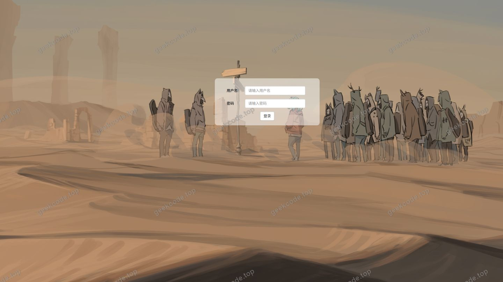
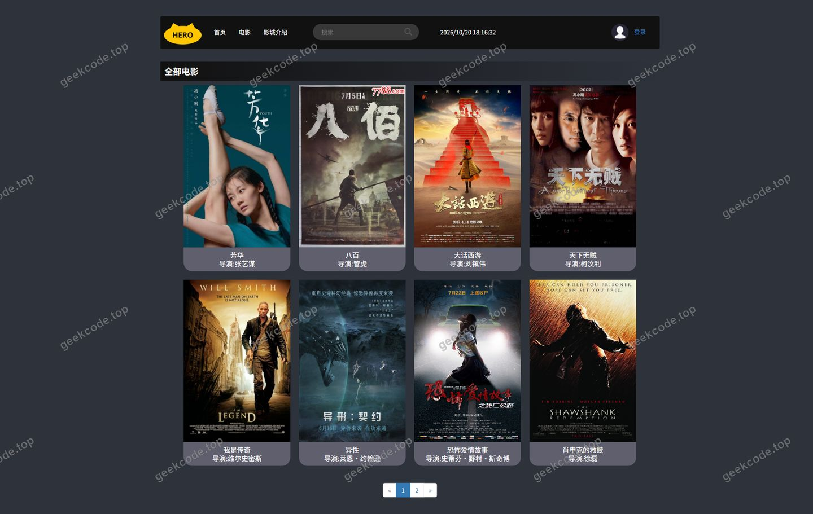
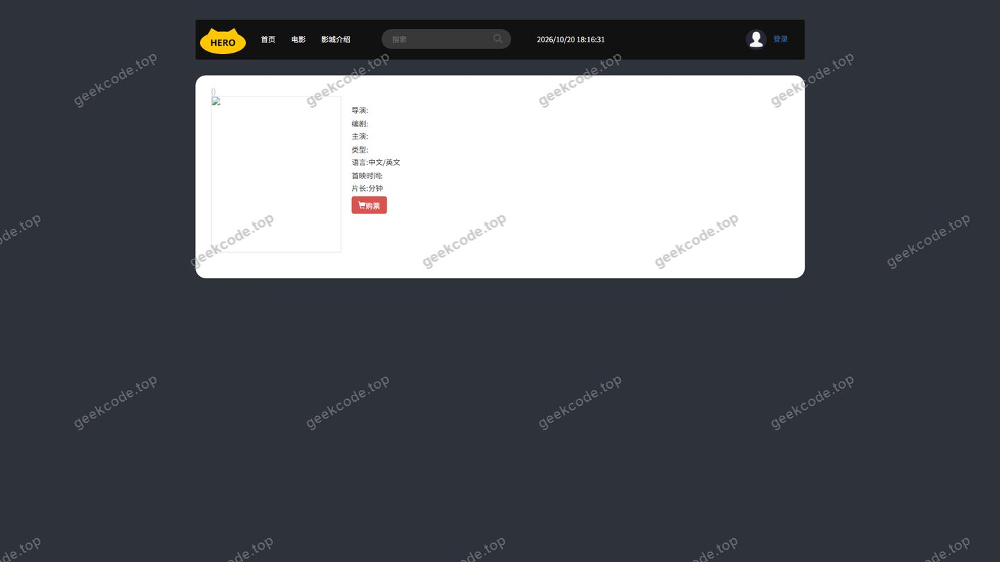
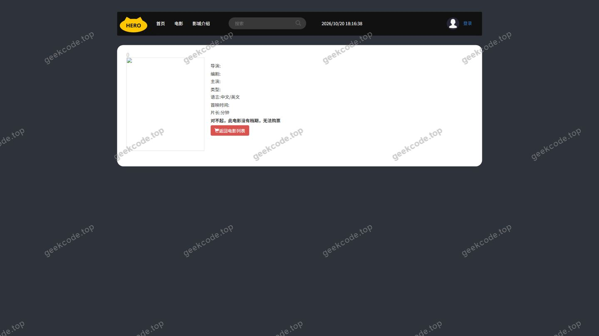
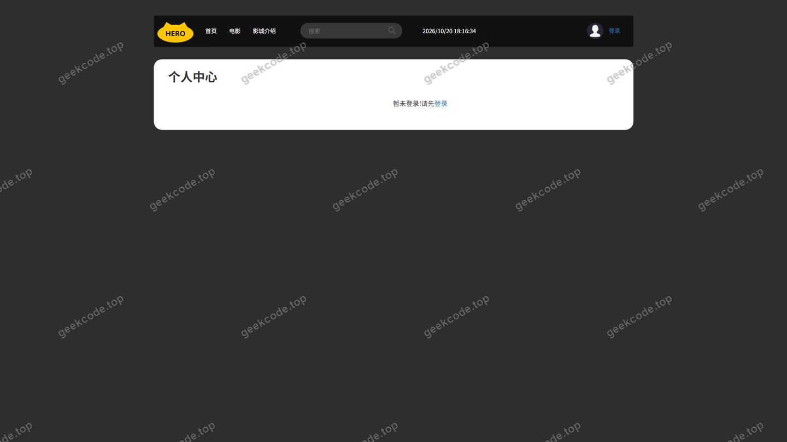
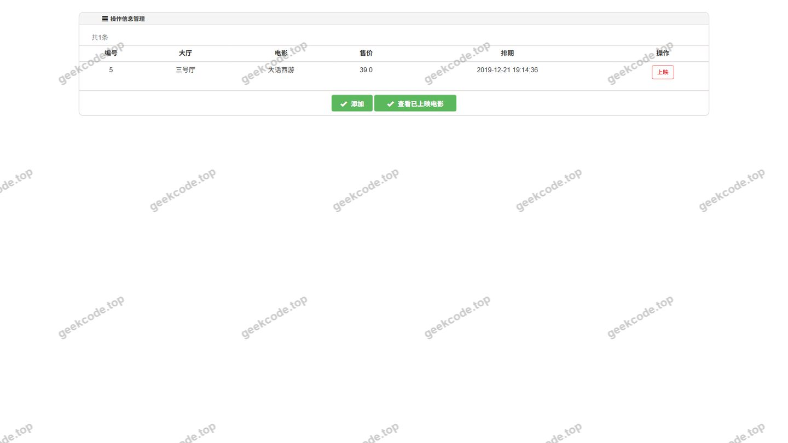
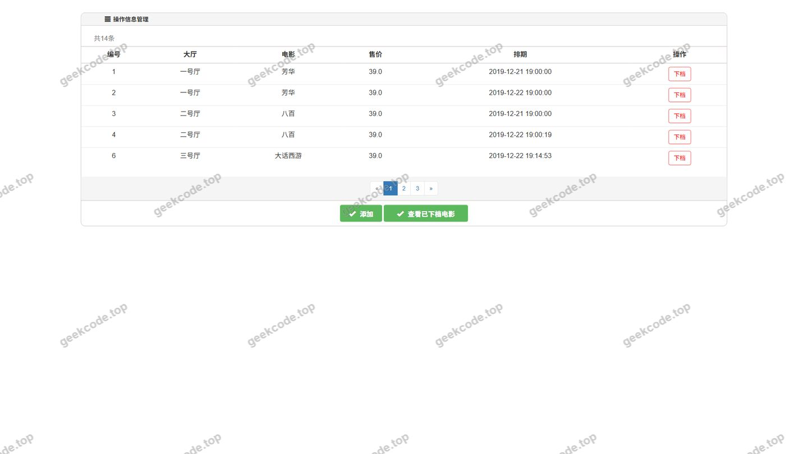
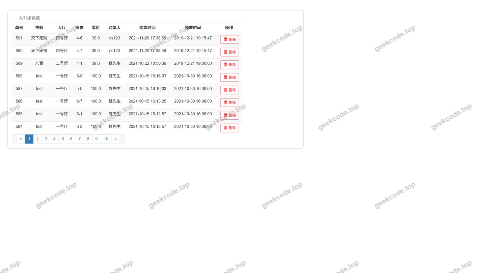
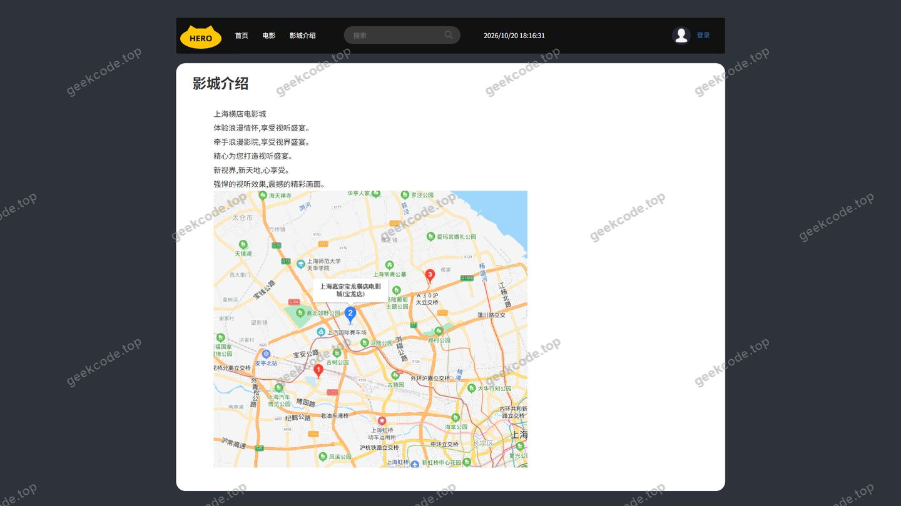

# 在线电影票购买系统

> 🎓 **计算机毕业设计 · 在线电影票购买系统**
>
> 本仓库只放**项目介绍 + 运行截图**（截图是站点带水印的原图，存在仓库 `images/` 里）。
>
> 👉 **完整可运行源码 / 数据库脚本 / 部署文档：[点我获取](https://geekcode.top/archives/%E5%9C%A8%E7%BA%BF%E7%94%B5%E5%BD%B1%E7%A5%A8%E8%B4%AD%E4%B9%B0%E7%B3%BB%E7%BB%9F?utm_source=github)**
>
> 💬 咨询微信：**ir9372**　|　🌐 更多项目：[极客代码 geekcode.top](https://geekcode.top/?utm_source=github)
>
> 📌 项目详情页：<https://geekcode.top/archives/%E5%9C%A8%E7%BA%BF%E7%94%B5%E5%BD%B1%E7%A5%A8%E8%B4%AD%E4%B9%B0%E7%B3%BB%E7%BB%9F?utm_source=github>

<table><td width="230" align="center"> <b>扫码加微信 ir9372</b></td><td valign="middle">📦 源码 = 项目介绍 + 全部运行截图 + 数据库 + 部署文档 👉 点上方任意截图，直接跳到 <b>极客代码 geekcode.top</b> 详情页</td></table>

---

<h1>在线电影票购买系统</h1>
<h2>项目概述</h2>

本项目为“在线电影票购买系统”，旨在构建一个基于 Web 的电影票务管理平台。虽然项目类型标记为 JSP，但核心后端逻辑采用 Spring Framework 与 MyBatis 进行数据持久层与业务层开发。系统主要服务于普通用户与管理者两类角色。对于普通用户，系统提供登录认证、个人信息查看、影院选择、影厅浏览、座位选择及购票（包括团体票）等功能；对于管理员，系统提供后台运行监控及管理页面。项目解决了传统线下购票排队时间长、选座不直观的问题，通过数字化流程提升购票效率。适用人群包括希望便捷购买电影票的观众以及负责票务运营的管理员。技术架构上，采用 MVC 设计模式，前端通过 JSP 页面展示，后端利用 Spring 管理 Bean 生命周期与事务，MyBatis 处理数据库交互。

<h2>技术架构</h2>

本系统采用经典的三层架构设计，结合 Java Web 技术栈实现前后端分离度较低的混合模式。

<ol>
<li><strong>表现层 (Presentation Layer)</strong>：</li>
</ol>
<ul>
<li>基于 JSP (JavaServer Pages) 技术构建动态网页。根据截图列表，包含登录页、首页、电影列表页、个人中心页、影院/影厅页、购票页等视图组件。</li>
<li>使用 <code>commons-logging</code> 进行日志记录，便于调试页面渲染过程中的异常。</li>
</ul>
<ol start="2">
<li><strong>业务逻辑层 (Business Logic Layer)</strong>：</li>
</ol>
<ul>
<li>核心框架为 <strong>Spring Framework</strong>。具体依赖包括 <code>spring-core</code>, <code>spring-beans</code>, <code>spring-context</code>, <code>spring-aop</code>, <code>spring-expression</code>, <code>spring-tx</code>。</li>
<li><strong>IoC/DI</strong>：利用 <code>spring-context</code> 和 <code>spring-beans</code> 实现依赖注入，解耦各业务模块。</li>
<li><strong>AOP</strong>：使用 <code>spring-aop</code> 处理横切关注点，如权限校验或日志记录。</li>
<li><strong>事务管理</strong>：通过 <code>spring-tx</code> 确保购票扣款、库存减少等操作的原子性。</li>
</ul>
<ol start="3">
<li><strong>数据访问层 (Data Access Layer)</strong>：</li>
</ol>
<ul>
<li>使用 <strong>MyBatis</strong> 作为 ORM 框架。它允许开发者直接编写 SQL 语句，灵活处理复杂的电影排期、座位锁定查询等业务。</li>
<li><code>spring-web</code> 和 <code>spring-webmvc</code> 提供了基础的 Web 请求处理能力，将 HTTP 请求映射到相应的 Controller 方法。</li>
</ul>
<ol start="4">
<li><strong>数据库设计要点</strong>：</li>
</ol>
<ul>
<li>虽然未提供详细 Schema，但根据功能模块推断，数据库需包含用户表、电影信息表、影院表、影厅表、座位表、订单表及管理员表。</li>
<li>重点在于座位状态的实时同步（已选/空闲/已售），以防止超卖现象。</li>
</ul>
<h2>功能模块</h2>

根据提供的截图功能列表，系统主要划分为以下功能模块：

<h3>用户端功能</h3>
<ul>
<li><strong>身份认证模块</strong>：</li>
<li><strong>登录页</strong>：提供用户输入账号密码进行系统接入的功能。</li>
<li><strong>资讯浏览模块</strong>：</li>
<li><strong>页面-we / 页面-filma</strong>：推测为首页或电影详情展示页，用于呈现最新上映电影海报、简介等信息。</li>
<li><strong>页面-列表</strong>：电影列表页，支持按条件筛选或展示所有可购票影片。</li>
<li><strong>交易流程模块</strong>：</li>
<li><strong>页面-room / 页面-deroom</strong>：影院与影厅选择页，用户可浏览不同影院及其下属影厅的排片情况。</li>
<li><strong>页面-ticket</strong>：标准购票页，包含座位选择、确认订单环节。</li>
<li><strong>页面-goupiao</strong>：团体票购买页，专门针对多人批量购票场景优化的界面。</li>
<li><strong>个人中心模块</strong>：</li>
<li><strong>页面-personal</strong>：用户信息管理页，可查看个人资料、历史订单等。</li>
</ul>
<h3>管理端功能</h3>
<ul>
<li><strong>后台管理模块</strong>：</li>
<li><strong>页面-管理员</strong>：管理员登录入口或基础管理界面。</li>
<li><strong>页面-运行页1 (admin)</strong>：系统运行状态监控或核心业务数据管理面板，用于管理员维护系统正常运作。</li>
</ul>
<h2>用户角色与权限</h2>

系统明确区分了两类主要用户角色，其权限分配如下：

<table>
<thead>
<tr>
<th align="left">角色</th>
<th align="left">可访问功能模块</th>
<th align="left">权限描述</th>
</tr>
</thead>
<tbody><tr>
<td align="left"><strong>普通用户</strong></td>
<td align="left">登录页、页面-we、页面-filma、页面-列表、页面-room、页面-deroom、页面-ticket、页面-goupiao、页面-personal</td>
<td align="left">拥有完整的购票链路权限，包括浏览电影、选择影院影厅、单人或团体购票、查看个人订单及资料。无法访问任何后台管理接口。</td>
</tr>
<tr>
<td align="left"><strong>管理员</strong></td>
<td align="left">页面-管理员、页面-运行页1</td>
<td align="left">拥有系统最高权限，负责后台数据的维护、用户管理、电影排期配置及系统运行状态监控。通常不直接参与前台购票流程。</td>
</tr>
</tbody></table>

<em>注：根据现有代码上下文，未提及教师、学生等其他特定角色，故仅定义上述两类通用角色。</em>

<h2>项目特色与创新点</h2>
<ol>
<li>
<strong>精细化票务场景支持</strong>：
   系统不仅支持常规的单人购票（<code>页面-ticket</code>），还专门设计了团体票购买流程（<code>页面-goupiao</code>）。这一设计贴合学校组织观影、公司团建等实际应用场景，提升了系统的商业实用价值。

</li>
<li>
<strong>基于 Spring+MyBatis 的高效数据交互</strong>：
   摒弃了传统的 JDBC 手动编码方式，引入 MyBatis 实现了 SQL 与 Java 代码的解耦。在处理复杂的座位查询和订单关联时，能够保持较高的执行效率和代码可维护性。

</li>
<li>
<strong>清晰的 MVC 分层结构</strong>：
   尽管前端使用 JSP，但后端严格遵循 Spring MVC 规范，利用 <code>spring-webmvc</code> 进行请求分发。这种结构使得业务逻辑（Service）、数据访问（DAO）和控制层（Controller）职责分明，降低了模块间的耦合度。

</li>
<li>
<strong>完整的用户旅程覆盖</strong>：
   从登录认证到最终的个人中心回顾，系统覆盖了用户购票的全生命周期。特别是 <code>页面-deroom</code> 和 <code>页面-room</code> 的设计，体现了对物理空间（影院-影厅）层级关系的准确建模。

</li>
</ol>
<h2>部署环境</h2>

为确保“在线电影票购买系统”正常运行，服务器端需配置以下软件环境：

<ol>
<li><strong>操作系统</strong>：Windows Server 或 Linux (CentOS/Ubuntu)。</li>
<li><strong>JDK 版本</strong>：建议 JDK 1.8 或以上版本，以兼容 Spring Framework 5.x 及以上版本的依赖库。</li>
<li><strong>Web 容器</strong>：Apache Tomcat 8.5 或更高版本（用于部署 WAR 包并解析 JSP 页面）。</li>
<li><strong>数据库</strong>：MySQL 5.7 或 MySQL 8.0。需安装对应的 JDBC 驱动包。</li>
<li><strong>构建工具</strong>：Maven 3.6+（用于管理 <code>commons-logging</code>, <code>spring-*</code>, <code>mybatis</code> 等依赖项）。</li>
<li><strong>浏览器</strong>：Chrome, Firefox, Edge 等现代主流浏览器（用于前端页面访问）。</li>
</ol>

<em>注意：由于项目类型为 JSP 且无 Node.js 相关依赖提及，无需安装 Node.js 或微信开发者工具。</em>

<h2>五、技术特性</h2>
<ul>
<li>服务端模板渲染（JSP）</li>
</ul>
<h2>六、功能模块截图</h2>
<h3>后台管理端</h3>
<h4>页面-运行页1</h4>

<h4>登录页</h4>

<h4>页面-管理员</h4>

<h4>页面-列表</h4>

<h4>页面-filma</h4>

<h4>页面-goupiao</h4>

<h4>页面-personal</h4>

<h4>页面-deroom</h4>

<h4>页面-room</h4>

<h4>页面-ticket</h4>

<h4>页面-we</h4>

---

## 获取完整源码

| 项目 | 说明 |
| --- | --- |
| 项目名 | 在线电影票购买系统 |
| 运行截图 | 本文 11 张（站点带水印原图，仓库 `images/` 目录） |
| 完整源码 | [https://geekcode.top/archives/%E5%9C%A8%E7%BA%BF%E7%94%B5%E5%BD%B1%E7%A5%A8%E8%B4%AD%E4%B9%B0%E7%B3%BB%E7%BB%9F?utm_source=github](https://geekcode.top/archives/%E5%9C%A8%E7%BA%BF%E7%94%B5%E5%BD%B1%E7%A5%A8%E8%B4%AD%E4%B9%B0%E7%B3%BB%E7%BB%9F?utm_source=github) |
| 咨询微信 | **ir9372**（备注：jingpin-yuanma） |
| 更多项目 | [极客代码 geekcode.top](https://geekcode.top/?utm_source=github) |

> 需要源码、部署、改配置、跑不起来等问题，加微信 ir9372 沟通，说明项目名即可。
